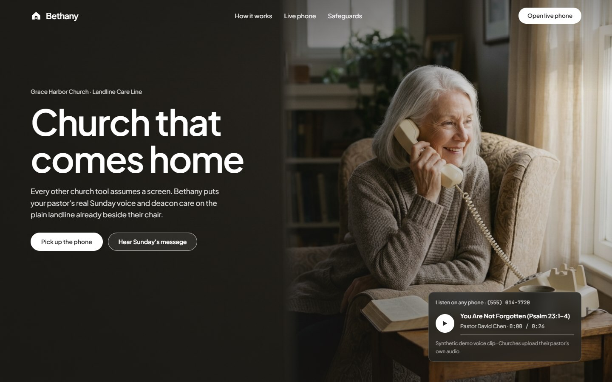
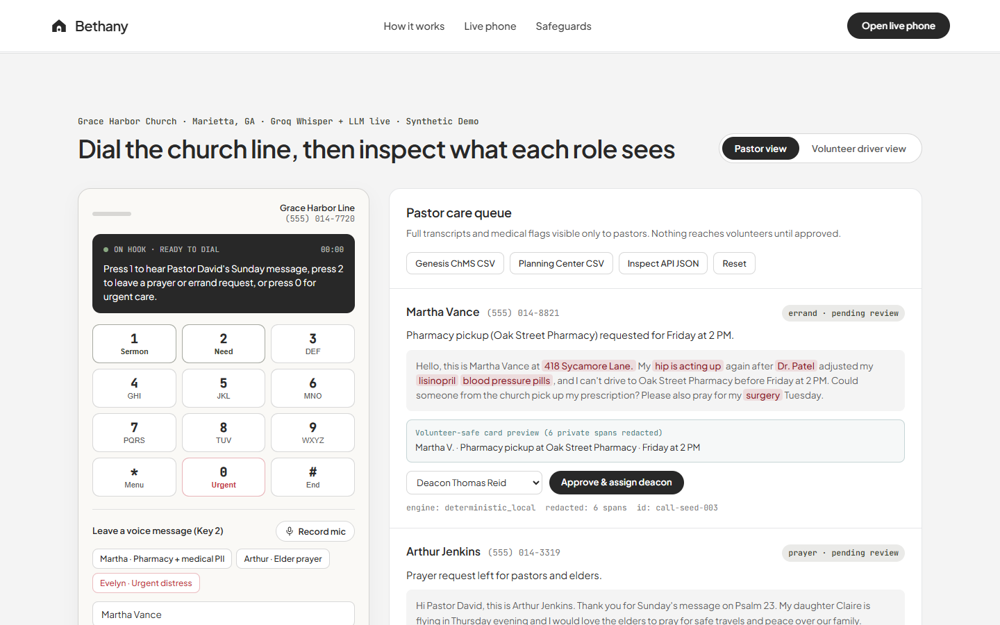
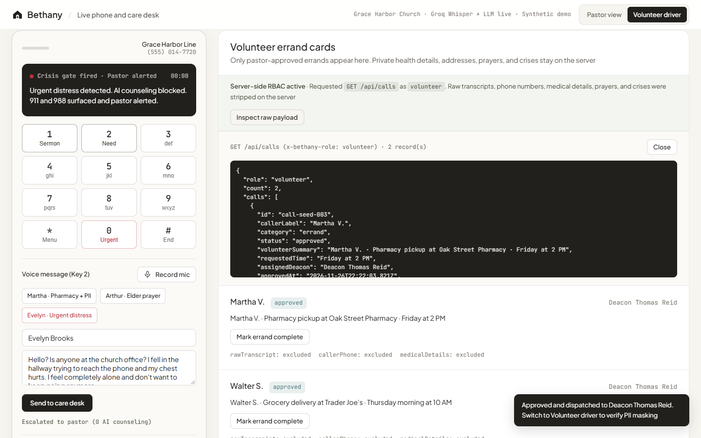

# Bethany

**Church that comes home.** Church AI over plain landlines.

[](https://bethany-sigma.vercel.app)
[](LICENSE)
[](test/backend.test.mjs)
[](package.json)
[](https://aiforchurch.com/hackathon)

All 34 projects listed in the AI for Church Hackathon gallery require a screen, a web browser, or a smartphone. Homebound seniors, nursing-home residents, and blind or low-vision church members often cannot use those tools, so they miss Sunday messages and mid-week help.

Bethany gives a congregation one phone number that works from any rotary or push-button landline. A member dials in, presses `1` to hear their pastor's own recorded Sunday message, presses `2` to speak a prayer or errand request, or presses `0` for urgent care. AI transcribes and structures the voicemail. Plain deterministic code handles crisis escalation, medical privacy redaction, pastor sign-off, and volunteer dispatch.



## Try It in 10 Seconds (`/phone` or `/judge`)

Click **Open live phone** on the landing page (opens `/phone` in a dedicated tab) or go straight to `/judge`. You do not need an account, a phone number, or an API key to test every path:

1. **Press `1` on the keypad** to hear the pastor's Psalm 23 message stream from `GET /api/sermon/audio` and inspect the Twilio TwiML XML that a real phone call receives.
2. **Press `2` (or click a synthetic caller preset)** to send a spoken voice message through live Groq Whisper transcription or pre-seeded fixtures.
3. **Inspect the Pastor care queue:** see Martha Vance's full transcript with 6 private spans highlighted (`418 Sycamore Lane`, `Dr. Patel`, `lisinopril`, `surgery`), then click **Approve & assign deacon**.
4. **Test the crisis gate:** click **Evelyn · Urgent distress** and watch the deterministic crisis gate pin an urgent alert to the top of the pastor queue with AI counseling blocked and 988/911 guidance surfaced.
5. **Switch to Volunteer driver view** and click **Inspect raw payload**. The browser requests `GET /api/calls` with `x-bethany-role: volunteer`. Medical details, street addresses, phone numbers, private prayers, and crisis records are absent from the server JSON.
6. **Export to your ChMS:** download a formula-sanitized **Genesis ChMS** or **Planning Center People** CSV from Pastor view.





## How the Architecture Splits AI and Deterministic Code

AI reads messy spoken voicemails. Deterministic code owns every safety, privacy, and workflow decision:

```
Plain Landline (Twilio /api/twiml) or Browser Touch-Tone Handset (/judge)
  |
  |-- Press 1 --> Real Pastor WAV Audio (/api/sermon/audio, HTTP 206 Range)
  |
  |-- Press 0 --> Immediate Urgent Pastoral Escalation + 911 / 988 Notice
  |
  |-- Press 2 --> Spoken Voicemail (/api/transcribe via Groq Whisper or Text)
                    |
                    v
         [Deterministic Crisis Gate]  (src/core/triage.mjs)
           |-- Self-harm / Abuse / Medical / Acute Distress?
           |     --> Block AI counseling (aiCounselingBlocked: true)
           |     --> Pin urgent pastor callback + 988 / 911 resources
           |     --> Reject volunteer dispatch (HTTP 409)
           |
           v (Ordinary care message)
         [AI Structured Intake]       (Groq gpt-oss-20b / Gemini / Local fallback)
           |
           v
         [Deterministic PII Redactor] (Strips addresses, units, phones, doctors, meds)
           |
           v
         [Pastor Review Queue]        (uiOnly: true; prayers blocked from volunteers with 409)
           |
           |-- Approve Errand --> [Server-Side RBAC Projection] (src/core/rbac.mjs)
           |                        --> Volunteer sees safe errand card only
           |
           |-- Export CSV ------> Genesis ChMS & Planning Center People CSV (OWASP sanitized)
```

In Barna and Gloo research on church AI (October 2026), 94% of pastors reported concern about AI misinterpreting Scripture and 71% to 94% required immediate human handoff for spiritual, abuse, medical, or self-harm crises. Bethany enforces that boundary in code rather than prompt instructions: pressing `1` plays recorded human pastor audio, and urgent distress never reaches an LLM prompt.

## Implemented vs. Planned

| Capability | Status | Details |
| :--- | :--- | :--- |
| Zero-dependency Node 24 HTTP API and static web UI | Implemented | Uses `node:http`, `node:sqlite`, `node:crypto`, and `node:test` (`0` npm runtime packages). |
| Unified IVR state machine and Twilio TwiML webhook | Implemented | `POST /api/twiml` and `POST /api/simulate/dtmf` run the same `src/core/ivr.mjs` state machine with HMAC-SHA1 `X-Twilio-Signature` validation. |
| Real pastor audio streaming with Range support | Implemented | `GET /api/sermon/audio` streams `data/pastor-sunday-recap.wav` (37s Psalm 23 demo voiceover, HTTP `200`/`206`/`416`). |
| Live speech-to-text and structured extraction | Implemented | `POST /api/transcribe` supports free-tier Groq (`whisper-large-v3-turbo`), Gemini (`gemini-2.5-flash`), or OpenAI; extraction supports Groq (`openai/gpt-oss-20b`), Gemini, OpenAI, and deterministic local fallback. |
| Deterministic crisis gate and PII redaction | Implemented | Catches self-harm, abuse, medical emergencies, and acute spiritual distress before LLM calls; redacts addresses, units, phones, emails, doctors, and medications. |
| Server-side RBAC and `Rock#7183` caller scoping | Implemented | Defaults to `volunteer`; strips sensitive fields before JSON serialization; unknown `callerId` queries return `0` records. |
| Genesis ChMS and Planning Center CSV export | Implemented | Pastor-only endpoint with OWASP spreadsheet formula sanitization. |
| Serverless persistence on Vercel | Implemented | Syncs across serverless instances via zero-dependency Upstash Redis REST when configured, with `/tmp/bethany.db` fallback on Vercel read-only filesystems. |
| Production auth and live church phone onboarding | Planned | Replace `/judge` demo role header (`x-bethany-role`) with signed HTTP-only sessions, per-church tenant RLS, and self-serve Twilio number provisioning. |

## Verification and Machine-Generated Evidence

Every claim is backed by runnable commands that exit with code `0`. Run the full verification pipeline locally:

```bash
npm run verify      # 21 deterministic unit + integration + audit regression tests + check:words
npm run smoke       # Boot server, verify health, audio, and Pastor vs. Volunteer RBAC counts
npm run check:words # Enforce plain-language docs (0 banned marketing buzzwords)
npm run evidence    # Re-generate evidence/backend-report.json with live probe latencies
```

Latest probe snapshot from [`evidence/backend-report.json`](evidence/backend-report.json) (Node `v24.18.0`, `0` external dependencies):

| Probe | Measured Result | Latency |
| :--- | :--- | :--- |
| Automated test suite (`test/backend.test.mjs`) | `21/21` tests passing (including audit and Vercel rewrite regressions) | `~3.0s` |
| Deterministic crisis gate (`Evelyn` distress preset) | HTTP `201`, `urgentEscalated: true`, `aiCounselingBlocked: true`, flags `["self_harm", "medical_emergency"]` | `66.04ms` |
| Server-side RBAC + `Rock#7183` probe | Volunteer sees `1` approved call, `rawTranscript: false`, CSV export HTTP `403`, unknown `callerId` count `0` | `23.99ms` |
| Twilio TwiML webhook (`Digits=1`) | HTTP `200`, valid XML `<Play>.../api/sermon/audio</Play>` | `13.93ms` |

## Engineering Notes and Security Audit

- **Why zero external dependencies:** Churches running on small budgets need software that stays running without package churn. Node 24 LTS ships built-in SQLite (`node:sqlite`), `fetch`, `FormData`, `crypto`, and `node:test`, keeping deployment cold starts fast and bundle size minimal.
- **Cutting Groq extraction latency from 10.5s to 728ms:** On Groq's free tier, `openai/gpt-oss-20b` defaults to extended reasoning tokens. Passing `reasoning_effort: "low"` with `response_format: { type: "json_object" }` kept JSON extraction accurate while bringing live extraction down to `728ms`.
- **Second-pass adversarial audit ([`AUDIT.md`](AUDIT.md)):** Before code freeze, a line-by-line review caught 5 real defects (unvalidated `x-forwarded-proto`/`x-forwarded-host` headers in TwiML URLs, missing self-harm variants, approving private prayer requests or already-resolved errands in `store.mjs`, and non-atomic SQLite snapshot imports). All 5 were patched and covered by failing-first regression tests.
- **Synthetic data (Hackathon Rule 5):** All congregation names, messages, and `(555) 014-xxxx` numbers belong to the fictional *Grace Harbor Church* demo fixture. The included Psalm 23 clip is a synthetic voice recording labeled clearly in the UI; real churches upload their own pastor's audio.

## Run Locally or Deploy to Vercel

### Local (Zero Setup)

```bash
git clone https://github.com/GreatSage-dev/bethany.git
cd bethany
npm start
```

Open `http://localhost:3001` (or `http://localhost:3001/judge`). Without an API key, Bethany runs end to end using the deterministic local extractor. To enable live microphone speech-to-text and LLM structuring, copy `.env.example` to `.env` and add a free `GROQ_API_KEY` (or `GEMINI_API_KEY`).

### Deploy on Vercel

1. Import `GreatSage-dev/bethany` in Vercel (uses `api/index.js`, `public/`, and `vercel.json` with Node 24 LTS).
2. Add `GROQ_API_KEY` in Project Settings -> Environment Variables for live Whisper transcription and structured extraction.
3. Optional: attach free **Upstash Redis** from the Vercel Marketplace (`UPSTASH_REDIS_REST_URL` and `UPSTASH_REDIS_REST_TOKEN`) to persist care queue updates across serverless cold starts.
4. Optional: set `TWILIO_AUTH_TOKEN` and point any Twilio voice number webhook (`POST`) to `https://<your-vercel-domain>/api/twiml` to dial Bethany from a real landline or mobile phone.

See [`CONTRIBUTING.md`](CONTRIBUTING.md) to run tests or open a pull request, and [`LICENSE`](LICENSE) (MIT).
